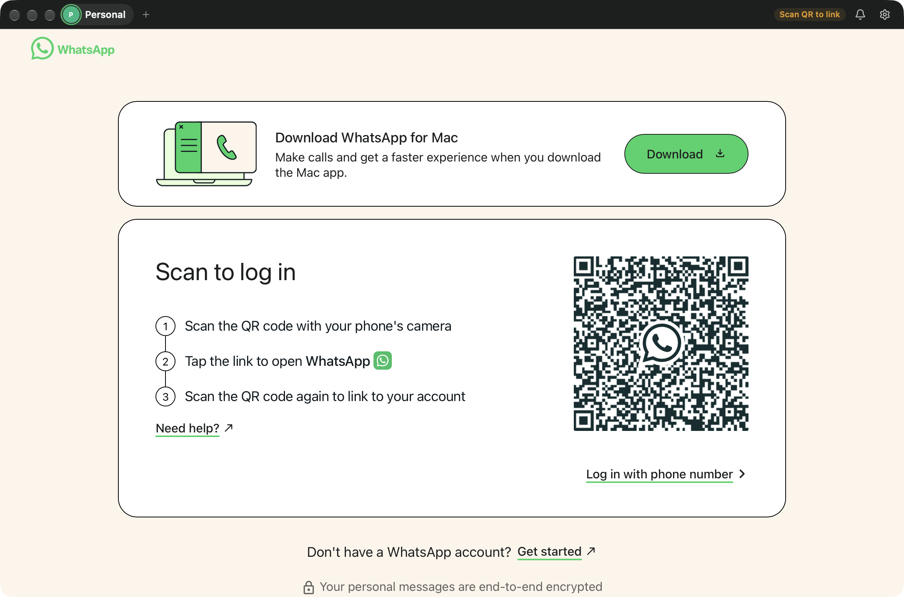
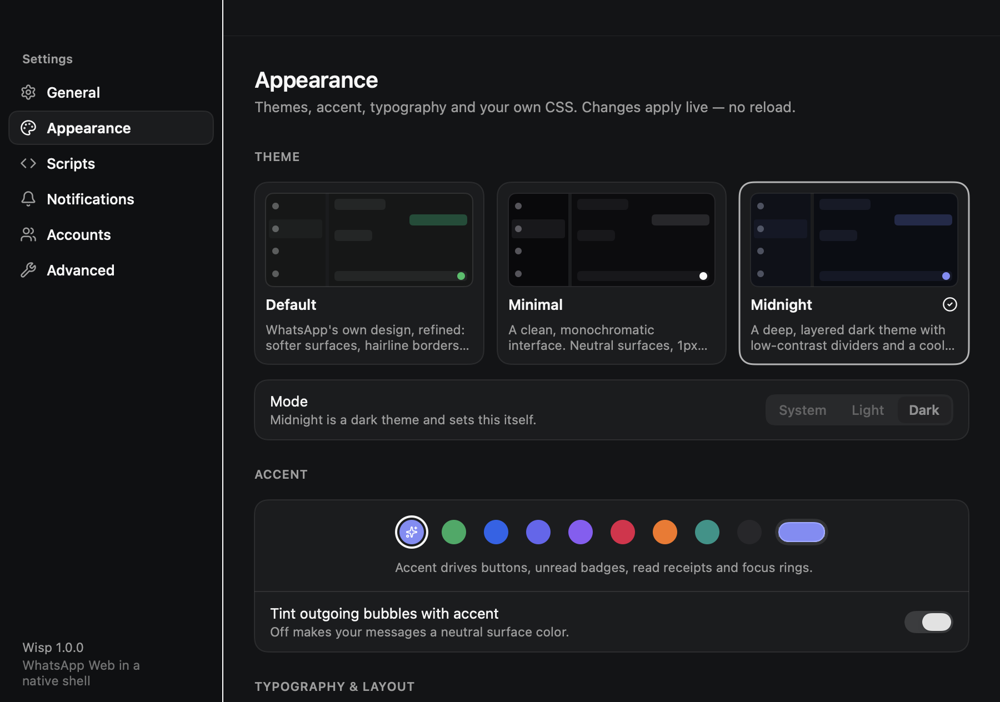
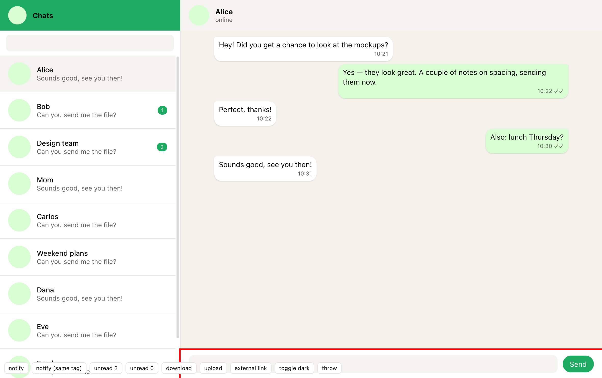
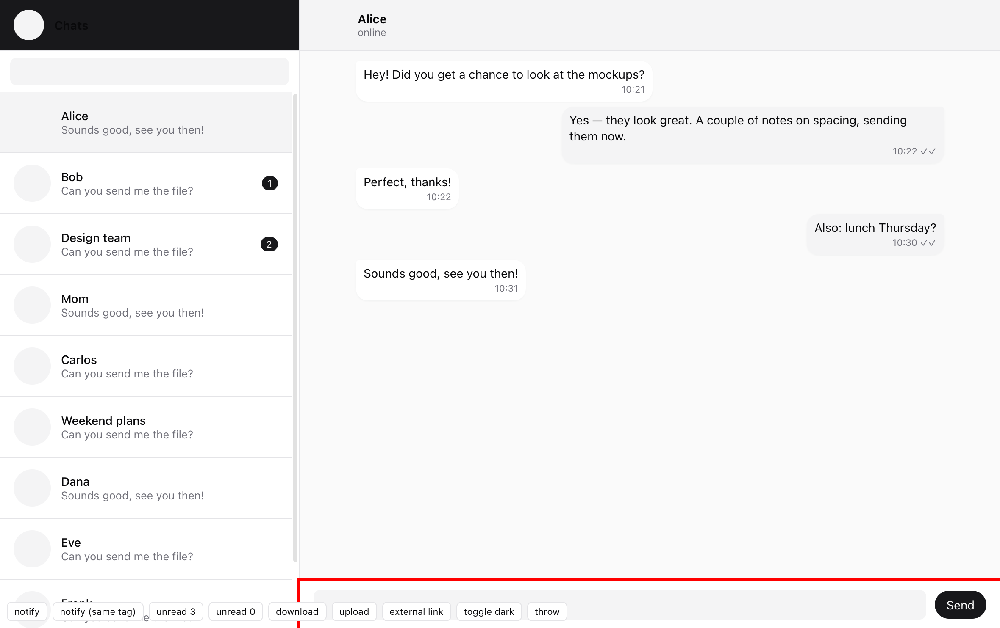
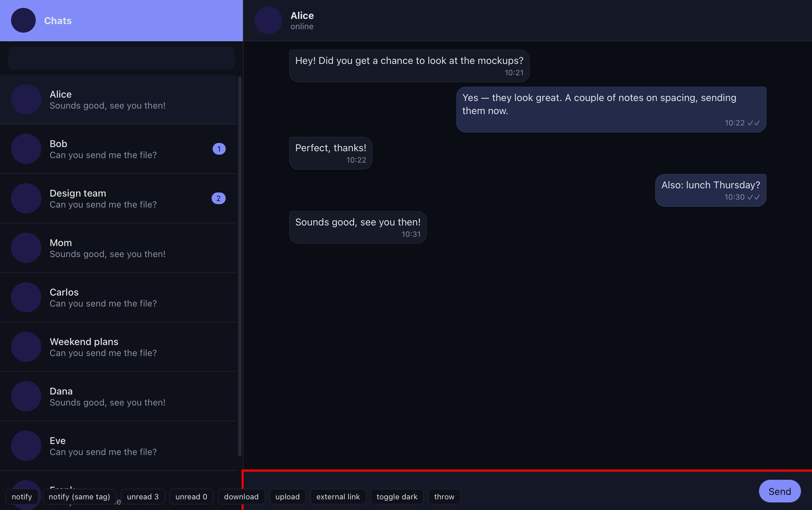

# Wisp

A native, ultra-light macOS client for WhatsApp Web. Swift + SwiftUI shell, a single persistent `WKWebView` per account, native notifications, and an Appearance Studio that reskins WhatsApp Web through CSS variables and user scripts.

Wisp loads the official `https://web.whatsapp.com` and leaves WhatsApp's end-to-end encryption and session model untouched. No Electron, no bundled Chromium, no private APIs.

> WhatsApp is a trademark of WhatsApp LLC. Wisp is an independent, unofficial client shell that loads the official WhatsApp Web and is not affiliated with or endorsed by WhatsApp or Meta.

## Features

**Core**
- QR login with persistent sessions (per-account `WKWebsiteDataStore`); nothing is cleared on quit.
- One long-lived web view per account. Opening Settings or switching accounts never recreates it.
- Automatic reload after a failed load (exponential backoff) and when the network returns (`NWPathMonitor`); recovery from a crashed web content process.
- Native file picker for attachments, native `WKDownload` handling into `~/Downloads` (or "ask where to save"), download notifications and "Show in Finder".
- Microphone and camera permission handling for voice messages and calls.
- External links open in your default browser; the chat view never navigates away from WhatsApp.

**Native macOS**
- Native title bar with traffic lights inside a 38 pt header, system light/dark appearance, window frame restoration.
- Dock badge with total unread count, menu bar item with unread count and a quick menu (accounts, mute, reload, settings, quit).
- Menu bar mode (hide the Dock icon), keep running when the window closes, start hidden, launch at login (`SMAppService`), confirm-before-quit.
- Global show/hide shortcut (default ⌃⌥W, recordable in Settings).

**Notifications**
- Native Notification Center banners for new messages with sender, preview, avatar and sound; click opens the right chat.
- Per-account enable / mute / preview overrides, global mute (toggle, 1 hour, until tomorrow), hide previews, duplicate suppression, suppression while the account is in front.
- Focus / Do Not Disturb are honored by the system.

**Appearance Studio**
- Three built-in themes: **Default** (refined WhatsApp), **Minimal** (monochrome, shadcn-inspired), **Midnight** (deep dark, indigo accent).
- Light / dark / system mode, accent presets or any custom color, font family, interface scale, message text size, comfortable / compact density, rounded bubbles with adjustable radius, optional fixed sidebar width.
- Custom CSS editor with syntax highlighting, brace validation and live preview. Preset import / export as JSON.
- All changes apply live. No reload.

**Scripts**
- Userscript-style manager: multiple scripts, enable / disable, document-start or document-end, isolated or page-context world.
- Built-in JavaScript editor with syntax highlighting and syntax checking (scripts with syntax errors are never injected).
- Per-script error capture and an execution log, hot reload from the Scripts folder, import `.js` files (start disabled).
- One-click "Reset all customizations".

**Multi-account**
- Isolated sessions per account, independent unread counts and notification settings, avatar + color, keep-loaded-in-background per account, account switcher in the header, ⌘1–9.

**Diagnostics**
- In-app diagnostics log (never contains message content), theme selector hook check, cache clearing without logging out, Web Inspector toggle.

## Screenshots

| | |
|---|---|
|  |  |
|  |  |
|  | |

## Quick start

Requirements: macOS 14 or later, Xcode 16 or later (built with Xcode 27), [XcodeGen](https://github.com/yonaskolb/XcodeGen).

```sh
brew install xcodegen
cd Wisp
xcodegen generate
open Wisp.xcodeproj      # Run the "Wisp" scheme
```

Or build and launch from the terminal:

```sh
scripts/dev-run.sh          # real WhatsApp Web
scripts/dev-run.sh --mock   # bundled mock page, no phone needed
```

Local notification testing needs a real signing identity; see [docs/BUILD.md](docs/BUILD.md).

## Keyboard shortcuts

| Shortcut | Action |
|---|---|
| ⌘R | Reload WhatsApp |
| ⌘⇧R | Hard reload (ignore cache) |
| ⌘F | Search chats |
| ⌘, | Settings |
| ⌘W | Hide window (Wisp keeps running) |
| ⌘Q | Quit |
| ⌘1 … ⌘9 | Switch account |
| ⌘⇧N | New account |
| ⌘⇧M | Mute / unmute notifications |
| ⌘⌥0 | Show Wisp |
| ⌘+ / ⌘− / ⌘0 | Zoom in / out / actual size |
| ⌃⌥W (global, configurable) | Show / hide Wisp from any app |

## Where your data lives

Wisp is sandboxed. Everything is inside its container:

```
~/Library/Containers/app.wisp.desktop/Data/Library/Application Support/Wisp/
  settings.json      preferences
  accounts.json      account list and per-account notification settings
  custom.css         your custom stylesheet
  Scripts/           one .js file per user script (+ order.json)
  Avatars/           custom account avatars
```

WhatsApp's own session data (cookies, IndexedDB, caches) is stored by WebKit under per-account data store identifiers inside the same container. Removing an account deletes its store.

## Documentation

- [docs/ARCHITECTURE.md](docs/ARCHITECTURE.md) — modules, injection layering, theme pipeline, notification bridge
- [docs/CUSTOMIZATION.md](docs/CUSTOMIZATION.md) — Appearance Studio, CSS variables, scripts, presets
- [docs/BUILD.md](docs/BUILD.md) — building, debug hooks, signing, release and notarization
- [docs/TESTING.md](docs/TESTING.md) — test checklist and what was verified
- [docs/LIMITATIONS.md](docs/LIMITATIONS.md) — known limitations of WebKit and WhatsApp Web

## License and attribution

Lucide icons are used under the ISC license. The app icon and all Wisp code are original.
